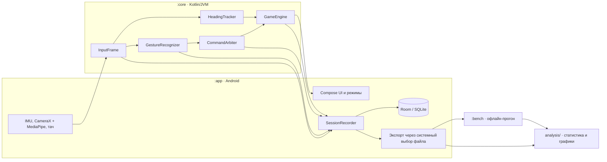
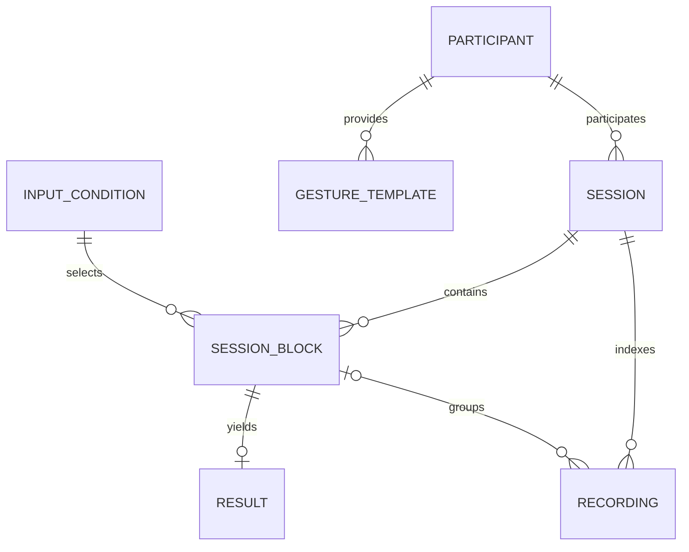

# Техническое задание «Пульт шамана»

НГУ ФИТ · ВРМП · Этапы 2–3 · 2026

## 1. Назначение и границы

«Пульт шамана» — офлайн-игра «Охота на духов» для Android. Игрок ищет духов по радару,
звуку и вибрации, ловит блуждающих и изгоняет злых. Игровая сессия длится 5–10 минут.
Приложение также служит установкой для сравнения тача, порогового распознавания IMU,
DTW по сигналам IMU и распознавания жестов рукой через камеру. В эксперименте правила
и задания одинаковы, меняется способ управления.

| Роль | Доступные действия |
|---|---|
| Игрок | Играть, освоить команды, пройти калибровку, выбрать способ управления. |
| Участник эксперимента | Пройти калибровку, тренировку и игровые задания в условиях, заданных экспериментатором. |
| Экспериментатор | Настроить и провести сессию, записать датасет, проверить и экспортировать записи. |
| Исследователь | Получить экспорт, воспроизвести поток кадров в бенчмарке и проанализировать результаты. |

Источник игровых правил — [спецификация](../SPEC.md), источник дизайна эксперимента —
[план исследования](../RESEARCH.md#часть-2-пользовательский-тест). Документ описывает
целевое приложение. В каркасе репозитория уже есть базовые типы, интерфейс и тач-распознаватель.
GameEngine, калибровка, тренажёр и сценарий эксперимента уже реализованы в main. Контракт общего арбитра, схема Room, PIN и упаковка экспорта приведены как проектные
предложения для обсуждения и реализации.

## 2. Функциональное проектирование

Дискретные команды проходят через один арбитр. Сканирование работает непрерывно.

| Действие | Пороги и DTW | Камера | Тач |
|---|---|---|---|
| Сканировать | Поворот корпуса с телефоном | Поворот корпуса с телефоном | Горизонтальный свайп |
| Поймать | Рывок телефона вверх | Сжать открытую ладонь в кулак | «Поймать» |
| Изгнать | Круг телефоном | Круг кончиком указательного пальца | «Изгнать» |
| Отменить | Встряхивание телефона | Взмах ладонью | «Отмена» |

### UC‑01. Выбрать способ управления и начать игру

**Актор.** Игрок. **Предусловие.** Приложение открыто на главном экране.

1. Игрок открывает настройки или выбирает «Играть». Приложение показывает выбранное управление.
2. Игрок выбирает тач, пороги, DTW или камеру. Приложение проверяет доступность нужных датчиков, разрешений и калибровки.
3. Игрок подтверждает запуск. Приложение открывает раунд или переводит к нужному шагу калибровки.

**Отклонения.** При недоступном датчике или отклонённом разрешении приложение объясняет причину
и предлагает выбрать доступное управление в обычной игре. В эксперименте условие сохраняется
за участником, а блок откладывается или помечается как прерванный.

**Постусловие.** Выбранное управление известно игроку. Раунд запускается при выполненных предусловиях.

### UC‑02. Откалибровать ввод

**Акторы.** Игрок, участник эксперимента. **Предусловие.** Выбран режим, требующий калибровки.

1. Игрок направляет телефон вперёд и нажимает «Зафиксировать». Приложение запоминает нулевое направление.
2. Для IMU игрок по подсказкам выполняет по пять повторов каждого жеста. Приложение подтверждает принятый пример, обновляет счётчик, проверяет пороги и сохраняет эталоны для DTW.
3. Для камеры игрок показывает открытую ладонь. Приложение проверяет видимость кисти и подсказывает, как изменить положение руки или освещение.
4. Игрок завершает калибровку. Приложение возвращается к запуску игры или тренировке.

**Отклонения.** Неудачный повтор предлагают сделать заново. При потере разрешения или видимости
кисти приложение показывает причину и оставляет соответствующий шаг незавершённым.

**Постусловие.** Приложение располагает параметрами, достаточными для выбранного управления.

### UC‑03. Научиться выполнять команды

**Акторы.** Игрок, участник эксперимента. **Предусловие.** Управление доступно и откалибровано, если требуется.

1. Игрок открывает тренажёр. Приложение показывает команду, способ её выполнения и прогресс.
2. Игрок повторяет действие. Приложение даёт обратную связь и засчитывает успешный повтор.
3. После трёх успешных повторов тренажёр переходит к следующему жесту. Когда все жесты пройдены, приложение предлагает начать игру.

**Отклонения.** При ошибке остаётся текущая команда с подсказкой. В эксперименте действует
минутное окно тренировки для каждого условия по исследовательскому протоколу.

**Постусловие.** Тренажёр показывает результат. Измеряемое задание стартует отдельным блоком.

### UC‑04. Найти духа и завершить раунд

**Актор.** Игрок. **Предусловие.** Запущен раунд с заданным сидом.

1. Приложение размещает духов в скрытых направлениях и запускает таймер на 45–60 с.
2. Игрок поворачивает телефон или ведёт пальцем по экрану. Сканер обновляет направление.
3. При приближении луча к духу усиливается обратная связь. Радар показывает сигнал внутри конуса ±15°.
4. Игрок определяет тип цели и выполняет команду. По окончании раунда приложение показывает итог и открывает переход к следующему раунду либо завершению игры.

**Отклонения.** Уход необработанного духа учитывается как пропуск. Для обычной игры макет
предусматривает паузу с продолжением или выходом в меню. При прерывании измеряемого раунда
приложение останавливает ввод, помечает прогон и сохраняет уже полученные записи.

**Постусловие.** Известен результат раунда. Последовательность духов воспроизводима по сиду.

### UC‑05. Поймать или изгнать духа

**Актор.** Игрок. **Предусловие.** Идёт раунд.

1. Игрок выполняет команду для цели в луче. При предварительном распознавании приложение показывает состояние кандидата и короткую вибрацию.
2. Распознаватель подтверждает жест. Арбитр выдаёт команду, а движок проверяет направление, тип цели и, в игре, применимые правила ловушки и маны.
3. Движок сразу применяет успешное действие. Приложение даёт отклик, отражает результат и открывает двухсекундное окно отмены.

**Отклонения.** Неподтверждённый кандидат сбрасывается. Промах и неверная команда учитываются
как игровые ошибки. Арбитр подавляет повторное подтверждение обычной команды в течение
400 мс. Потеря руки более чем на 300 мс сбрасывает камерного кандидата.

**Постусловие.** Результат команды показан и записан с отметкой времени.

### UC‑06. Отменить команду

**Актор.** Игрок. **Предусловие.** Доступна отмена последнего применённого действия.

1. Игрок выполняет «Отмена» в пределах двух секунд после подтверждения.
2. Арбитр связывает отмену с исходной командой. Движок откатывает действие и возвращает духа.
3. Приложение обновляет состояние раунда и записывает отмену.

**Отклонения.** Если окно истекло или подходящего действия нет, состояние игры сохраняется.
При истечении окна исходная команда фиксируется. Отмена учитывается как отдельное событие.

**Постусловие.** Результат команды отменён либо зафиксирован по окончании окна.

### UC‑07. Укрыться от атаки

**Актор.** Игрок. **Предусловие.** Обычная игра, датчик приближения доступен, дух атакует.

1. Приложение предупреждает об атаке звуком и характерной вибрацией.
2. Игрок закрывает датчик приближения ладонью в течение 1,5 с. Приложение подтверждает укрытие.
3. При истечении времени без укрытия движок списывает одну жизнь и обновляет индикацию.

**Отклонения.** Доступность датчика проверяется до запуска механики. В эксперименте атаки отключены.

**Постусловие.** Атака завершена, число жизней известно.

### UC‑08. Рассеять туман, сменить ловушку или пополнить ману

**Актор.** Игрок. **Предусловие.** Обычная игра, соответствующий источник сигнала доступен.

| Действие | Основной поток | Отклонение |
|---|---|---|
| Рассеять туман | 1. Приложение показывает туман и сужает конус. 2. Игрок дует в микрофон. 3. Уровень выше порога не менее 300 мс рассеивает туман на 5 с. | При коротком шуме состояние сохраняется. При отказе в разрешении приложение сообщает, что действие недоступно. |
| Сменить ловушку | 1. Игрок нажимает «Громкость +» или «Громкость −». 2. Игра выбирает соответствующую ловушку и обновляет видимый индикатор. 3. Поимка проверяет соответствие цвета духа и ловушки. | Вне игрового экрана кнопки выполняют системное действие. |
| Пополнить ману | 1. Игрок открывает алтарь между раундами. 2. Подключает зарядку. 3. Игра пополняет ману и обновляет её индикатор. | Пополнение доступно на экране между раундами. |

**Постусловие.** Изменение видно на игровом экране. В эксперименте эти действия отключены.

### UC‑09. Провести экспериментальную сессию

**Акторы.** Экспериментатор, участник. **Предусловие.** Открыт режим эксперимента, согласие получено, оборудование проверено.

1. Экспериментатор вводит код `P01`–`P12`. Приложение рассчитывает порядок четырёх условий по сбалансированному квадрату 4×4 и подставляет сид по позиции блока.
2. Участник калибруется. Для каждой позиции приложение показывает способ ввода, запускает 1 мин тренировки и затем 3 мин измеряемого задания.
3. Экспериментатор проводит анкетирование после каждого условия. Приложение сохраняет результат и события блока, показывает прогресс и запускает следующий блок по подтверждению.
4. После четырёх условий приложение показывает итоги сессии. Экспериментатор проводит интервью по протоколу и при необходимости экспортирует запись.

**Отклонения.** Неверный код не запускает сессию. Ошибка ввода или записи отображается
в соответствующем блоке. При техническом сбое или отказе участника сессию останавливают,
сохраняя статус и различая полные и частичные прогоны.

**Постусловие.** Для каждого записанного блока доступны код, позиция, условие, сид, игровой результат и лог.
Анкета и интервью проводятся по исследовательскому протоколу под тем же кодом.

### UC‑10. Записать размеченный датасет

**Актор.** Экспериментатор. **Предусловие.** Код участника указан, IMU и камера доступны.

1. Экспериментатор выбирает жест и скорость или нулевую активность. Приложение показывает инструкцию и отсчёт.
2. Участник выполняет жест в окне 2,5 с либо выполняет указанную нулевую активность. Приложение параллельно пишет IMU и координаты кисти.
3. Приложение сохраняет запись с разметкой и показывает прогресс. Экспериментатор подтверждает запись или повторяет попытку.

**Отклонения.** При потере входного потока или ошибке записи попытка помечается как неполная.
Для нулевых записей приложение показывает текущую активность и время.

**Постусловие.** Доступна запись с анонимным кодом, синхронизированными потоками и разметкой,
когда запись относится к конкретному жесту.

### UC‑11. Экспортировать результаты

**Акторы.** Экспериментатор, исследователь. **Предусловие.** Доступ к записям разрешён, выбранная запись закрыта.

1. Экспериментатор открывает результаты, выбирает сессию или запись датасета и нажимает «Экспорт».
2. Приложение показывает состав экспорта и открывает системный выбор места сохранения.
3. Экспериментатор подтверждает место. Приложение записывает архив и сообщает результат.
4. Исследователь распаковывает архив и передаёт папку записи в `:bench` или `analysis/`.

**Отклонения.** Отмена диалога возвращает к результатам. При ошибке записи приложение сообщает
о неуспехе. Исходные данные остаются доступны для повторного экспорта.

**Постусловие.** Скачиваемый набор содержит метаданные и файлы протокола выбранного прогона.

### UC‑12. Настроить распознавание и проверить сигналы

**Акторы.** Игрок, экспериментатор. **Предусловие.** Активный измеряемый блок завершён.

1. Пользователь открывает настройки. Приложение показывает режим ввода и состояние оборудования.
2. Экспериментатор меняет параметры порогов или DTW и включает или выключает отладочный оверлей. Приложение проверяет диапазоны и сохраняет согласованный набор параметров.
3. При следующем запуске приложение применяет настройки и фиксирует параметры в метаданных записи.

**Отклонения.** Недопустимое значение сопровождается пояснением. Параметры измеряемой сессии
фиксируются при запуске и сохраняются в течение сессии.

**Постусловие.** Активный профиль виден пользователю и воспроизводим по параметрам в записи.

### UC‑13. Открыть режим экспериментатора по PIN (проектное предложение)

**Актор.** Экспериментатор. **Предусловие.** На устройстве задан локальный PIN экспериментатора.

1. Экспериментатор открывает «Эксперимент» или «Запись датасета». Приложение запрашивает PIN.
2. После проверки PIN приложение открывает выбранный раздел и разрешает операции исследовательской роли.
3. При выходе из защищённого раздела приложение закрывает доступ. Перед следующим входом требуется проверка PIN.

**Отклонения.** При неверном PIN приложение показывает сообщение и оставляет раздел закрытым.
Серия неудачных попыток временно ограничивает повторный ввод.

**Постусловие.** Защищённый раздел открыт только для локально подтверждённой роли.

## 3. Интерфейсное проектирование

[Файл Figma «Пульт шамана — интерфейс ТЗ»](https://www.figma.com/design/tTTyiXvLxIq4HonFBhJd1B) содержит
[дизайн-систему](https://www.figma.com/design/tTTyiXvLxIq4HonFBhJd1B?node-id=6-11334)
и [шесть экранов](https://www.figma.com/design/tTTyiXvLxIq4HonFBhJd1B?node-id=8-208).
На странице системы собраны светлая и тёмная палитры, типографика Roboto, шкала
отступов и скруглений, компоненты проекта и образцы Material 3 Design Kit.

В репозитории доступны PNG дизайн-системы и каждого экрана. Макеты показывают
типовые состояния. Порядок действий и правила переходов заданы сценариями.

- [Дизайн-система](screens/design-system.png)
- [Главное меню](screens/menu.png)
- [Игровой раунд](screens/game.png)
- [Калибровка](screens/calibration.png)
- [Тренажёр](screens/training.png)
- [Эксперимент](screens/experiment.png)
- [Итоги эксперимента](screens/results.png)

Экраны относятся к общей теме Material 3 Expressive. В Compose цветовые роли, типографика,
формы и анимации подключаются через `MaterialExpressiveTheme` с `MotionScheme.expressive()`.
Состояние распознавания читается по тексту и форме. Цвет дополняет сигнал. Основные
действия доступны с областями нажатия от 48 dp. [Документация Material 3 для Compose](https://developer.android.com/develop/ui/compose/designsystems/material3)

| Экран | Содержимое | Переходы |
|---|---|---|
| Главное меню | «Играть», «Тренировка», «Эксперимент», «Запись датасета», «Настройки», текущий способ ввода | В игру или подготовку, тренажёр, настройки, защищённый режим |
| Игра | Радар-дуга, оставшееся время, жизни, мана, текущая ловушка, туман, состояние команды и отмена. В тач-режиме отображаются кнопки команд | В результат раунда, следующий раунд или меню |
| Калибровка | Шаги нулевого направления, повторов IMU и проверки камеры в зависимости от условия | В тренажёр или в запуск задания |
| Тренажёр | Название команды, инструкция по жесту, результат повторения и счётчик успешных попыток | К следующему жесту или к старту игры |
| Эксперимент | Код участника, позиция блока, условие, сид и ход сессии | В калибровку, тренировку, задание и итоги |
| Итоги эксперимента | Пройденные блоки, состояние записи, число успешных действий и ошибок, экспорт | В выбор места сохранения или меню |

Дополнительные состояния для реализации — ввод PIN, разрешения Android, потеря руки,
ошибка записи и выход из незавершённого прогона. Экраны записи датасета и настройки
используют те же поля, кнопки, карточки и индикаторы.

## 4. Техническое проектирование

### 4.1. Архитектура и стек

| Компонент | Технология и назначение |
|---|---|
| Android | Kotlin, Compose и Material 3 Expressive. `minSdk 26`, `targetSdk 36`, `compileSdk 37`. Точная закреплённая версия Material 3 находится в [каталоге версий](../../gradle/libs.versions.toml). |
| Ввод | `SensorManager` подаёт линейное ускорение, угловую скорость и `GAME_ROTATION_VECTOR`. CameraX управляет жизненным циклом фронтальной камеры. MediaPipe Hand Landmarker в `LIVE_STREAM` преобразует кадры в координаты 21 точки кисти. [CameraX ImageAnalysis](https://developer.android.com/media/camera/camerax/analyze), [MediaPipe Hand Landmarker](https://github.com/google-ai-edge/mediapipe/tree/master/mediapipe/tasks/java/com/google/mediapipe/tasks/vision/handlandmarker) |
| Ядро | Kotlin/JVM и JUnit. Распознавание, азимут, арбитраж и правила игры детерминированы. Те же распознаватели выполняются на телефоне и в офлайн-бенчмарке. |
| Данные и экспорт | Room поверх SQLite для связанных сущностей и итогов. Высокочастотные записи в приватных файлах приложения. Пользователь выбирает место экспорта через Android Storage Access Framework. [Room](https://developer.android.com/training/data-storage/room), [системный выбор файла](https://developer.android.com/training/data-storage/shared/documents-files) |
| Анализ | JVM CLI воспроизводит записи. Python, pandas, scipy и matplotlib используются для статистики и графиков. |

Все входные потоки приводятся к монотонной шкале `elapsedRealtimeNanos`. Адаптер Android
сохраняет время отсчёта, проверяет шкалу источника камеры и передаёт кадры распознавателю
в порядке неубывания `tNanos`. Видеопиксели обрабатываются в памяти. Формат записи камеры
хранит только признак наличия руки и координаты кисти.

### 4.2. API ядра

Взаимодействие компонентов идёт через вызовы Kotlin и формат файлов экспорта. Развёртывание
HTTP-сервиса архитектурой не предусмотрено.

**Существующий контракт** — [GestureRecognizer.kt](../../core/src/main/kotlin/ru/nsu/vrmp/shaman/core/recognition/GestureRecognizer.kt)
и [RecognizerEvent.kt](../../core/src/main/kotlin/ru/nsu/vrmp/shaman/core/recognition/RecognizerEvent.kt).

| Операция | Вход | Результат и ограничения |
|---|---|---|
| `id: String` | — | Стабильный идентификатор `touch`, `threshold`, `dtw` или `camera`. |
| `reset(): Unit` | — | Сбрасывает состояние перед новым прогоном. |
| `onFrame(frame: InputFrame): List<RecognizerEvent>` | `ImuFrame`, `HandFrame` или `TouchFrame` с `tNanos`. | Неподдерживаемый тип даёт пустой список. `Candidate` содержит жест и время. `Detected` содержит жест, уверенность 0–1 и времена `tStart ≤ tEnd ≤ tEmit`. `Rejected` содержит время и причину. |
| `TouchRecognizer.onFrame` | `TouchAction.Press` или `TouchAction.Scan`. | Нажатие даёт `Detected` с уверенностью 1 и всеми временами, равными времени кадра. Свайп обрабатывается отдельным трекером направления. |

Пример для `TouchFrame(1_000_000_000, TouchAction.Press(Gesture.CATCH))`.
Распознаватель возвращает один `Detected(CATCH, 1.0, 1_000_000_000, 1_000_000_000, 1_000_000_000)`.

**Проектируемые операции** описывают обмен данными и семантику; имена методов будут
закреплены при реализации.

| Компонент и операция | Вход | Результат и обработка |
|---|---|---|
| `CommandArbiter` · принять событие | `RecognizerEvent`. | Состояние кандидата, подтверждение, отказ либо отмена. При подтверждении выдаёт команду с идентификатором. При отмене указывает исходную команду. Соблюдает окно 2 с и период 400 мс для обычных команд. |
| `CommandArbiter` · продвинуть время | `tNanos: Long` в шкале входных кадров. | Закрывает истёкшее окно отмены и выдаёт событие фиксации. Повторное продвижение к тому же времени не дублирует фиксацию. |
**Реализованный движок.** [GameEngine.kt](../../core/src/main/kotlin/ru/nsu/vrmp/shaman/core/game/GameEngine.kt)

| Метод | Назначение |
|---|---|
| `startRound(seed, startNanos, config)` | Инициализирует детерминированный раунд. |
| `update(tNanos, scannerYawRad)` | Обновляет состояние, таймер, направление и события. |
| `applyCommand(commandId, gesture, tNanos)` | Применяет команду и возвращает исход. |
| `cancelCommand(commandId, tNanos)` | Откатывает результат указанной команды. |
| `setHidden(hidden, tNanos)`, `disperseFog(tNanos)` | Обрабатывают укрытие и рассеивание тумана. |
| `switchTrap(trap, tNanos)`, `activateAltar(tNanos)` | Обрабатывают смену ловушки и пополнение маны. |
| `currentState()` | Возвращает текущий снимок раунда. |

### 4.3. Формат экспорта

Экспорт — архив с папкой записи в [формате проекта](../ARCHITECTURE.md#формат-записей).
Папка внутри архива соответствует `data/<kind>/<session_id>/`. Для экспериментальной
сессии из нескольких блоков архив включает отдельную папку с метаданными и потоком каждого
записанного условия. Прерванные прогоны маркируются в метаданных.

| Файл | Содержимое |
|---|---|
| `meta.json` | Код участника, условие, сид, устройство, версия приложения, git SHA и параметры распознавателей. |
| `imu.csv` | Монотонное время в нс, линейное ускорение, угловая скорость и ориентация. |
| `hand.csv` | Монотонное время в нс, наличие кисти и 21 тройка координат при наличии кисти. |
| `labels.csv` | Для записей датасета — временные границы, жест и скорость. |
| `events.jsonl` | События распознавателя, арбитра и игры с `t_ns`. |

Состав файлов зависит от источников записи. Для анализа экспериментального блока должны быть
доступны его позиция, условие и сид. Изменение схемы экспорта требует версии в `meta.json`
и согласованного обновления читающих компонентов `:bench` и `analysis/`.

### 4.4. Проект модели локальной БД

В текущем приложении профиль калибровки сохраняет `FileCalibrationStore`. В предложенной модели Room хранит связи и итоговые показатели. Потоки кадров и событий записываются последовательно
в отдельные файлы. Признак завершения в БД устанавливается после закрытия файлов. При
восстановлении приложения незакрытая запись помечается как прерванная.

| Сущность | Поля и ограничения |
|---|---|
| `participant` | `id` PK, уникальный анонимный код. |
| `session` | `id` PK, `participant_id` FK, вид (эксперимент или датасет), статус, версия приложения, git SHA и устройство. |
| `input_condition` | `id` PK, одно из значений `touch`, `threshold`, `dtw`, `camera`. |
| `session_block` | `id` PK, `session_id` FK, `condition_id` FK, позиция, сид, снимок параметров и статус. Пара «сессия, позиция» уникальна. У записи датасета измеряемых игровых блоков может не быть. |
| `gesture_template` | `id` PK, `participant_id` FK, жест, номер повтора и сохранённая последовательность признаков. |
| `result` | `block_id` PK/FK, число успешных команд, ошибок, пропусков и отмен. Исходные события остаются доступны для пересчёта. |
| `recording` | `id` PK, `session_id` FK, `block_id` FK для экспериментального блока, вид потока и относительный путь к файлу. Блок относится к той же сессии. |

### 4.5. Безопасность и права доступа

PIN и права защищённого режима описаны как предложение для согласования по #28.

- Роль игрока открывает обычный режим, тренажёр и настройки игрового ввода. Локальная
  проверка PIN открывает функции экспериментатора — выбор кода, запуск исследовательских
  прогонов, доступ к записям, изменение исследовательских параметров и экспорт. Контроль
  выполняется при входе и перед защищёнными операциями. Учётные записи проектом не предусмотрены.
- Проверочное значение PIN вычисляется с солью и функцией выработки ключа, например
  PBKDF2, и хранится в приватной области приложения. Приложение
  ограничивает частоту неудачных попыток и сбрасывает доступ при выходе из защищённого режима.
  PIN отделяет роли при работе на одном устройстве.
- `CAMERA` запрашивается в камерном вводе и записи датасета. `RECORD_AUDIO` запрашивается
  при использовании микрофона в обычной игре. В логах сохраняются координаты кисти,
  показания датчиков и события под анонимным кодом. Микрофон вычисляет уровень громкости
  в памяти. Фото, видео, аудиодорожки и имена участников не сохраняются.
- Файлы сессий и проверочные данные PIN хранятся в приватной области приложения и исключаются
  из резервного копирования. Сессии передаются только при явном экспорте в выбранное
  пользователем место. Защищённые операции не открываются через внешние компоненты Android.
  [Доступ к компонентам Android](https://developer.android.com/privacy-and-security/risks/access-control-to-exported-components)

## 5. Проверка и приёмка

| Проверка | Ожидаемый результат |
|---|---|
| Игра и управление | Игрок проходит сессию 5–10 мин. Доступны сканирование, поимка, изгнание и отмена. Для одного сида последовательность духов совпадает при разных способах ввода. |
| Калибровка и обучение | Сохраняются нулевое направление и образцы DTW, камера показывает готовность руки. Тренажёр засчитывает по три успешных повтора на жест. |
| Арбитр | Синтетические потоки проверяют кандидата, подтверждение, откат в пределах 2 с, истечение окна и подавление повторов за 400 мс. |
| Сопоставимость условий | Все четыре условия доступны в запланированном порядке. Сид связан с позицией. Дополнительные события отключены. Тренировка и задание различимы в записи. |
| Запись и экспорт | Сессия идентифицируется по коду, условию и сиду. После экспорта записи читаются офлайн, время и итоговые события сопоставимы. Ошибка экспорта оставляет исходную запись доступной. |
| Приватность | При отклонённом разрешении приложение сообщает о недоступной функции. В экспорте отсутствуют имена и исходные медиа. |
| Макеты | На странице дизайн-системы видны цветовые роли, шрифт и компоненты. Как минимум четыре экрана используют эту систему и показывают основные сценарии. |

Критерии курса и этапы реализации приведены в [плане проекта](../ROADMAP.md#критерии-приёмки-согласовано-с-преподавателем).
До сдачи требуется уточнить у преподавателя применимость внутреннего Kotlin API,
локальной SQLite/Room и PIN к требованиям по API, БД и контролю доступа.
